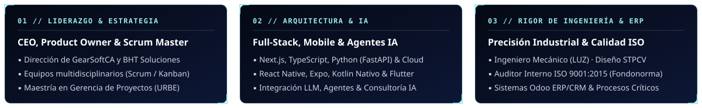
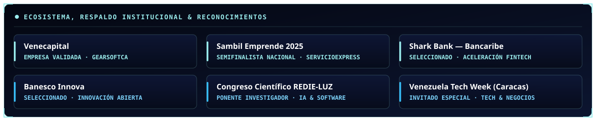

 

 

### ⚡ Visión Ejecutiva & Liderazgo Tecnológico

> Fusiono la precisión analítica de la **Ingeniería Mecánica** y la **Maestría en Gerencia de Proyectos Industriales** con el desarrollo de software moderno, **Inteligencia Artificial** y sistemas **ERP** para liderar productos digitales de alto impacto en Latinoamérica, respaldado por certificación como **Auditor Interno ISO 9001:2015** y **Scrum Master**.

  

 

  

 

### 🚀 Trayectoria de Liderazgo & Experiencia

* **Fundador & CEO | Forward Deployed Engineer · Product Owner · Scrum Master** — **[GearSoftCA](https://gearsoftca.com/)** *(Septiembre 2020 – Presente)*
  * Dirección ejecutiva, diagnóstico corporativo y especificación técnica de diseño (**SDD**) liderando el ciclo completo de productos digitales como Product Owner y Scrum Master.
  * Arquitectura y lanzamiento *end-to-end* de **[ServicioExpress](https://servicioexpress.vercel.app/)** (React Native, Firebase), **SellerPanel / ClickPanel** (Next.js, REST APIs), **[STPCV](https://play.google.com/store/apps/details?id=com.gearsoftca.stpcv&hl=es)** (Kotlin, Android SDK), backends en **Python (FastAPI)** e implementaciones de **Odoo ERP**.
  * Empresa validada por **Venecapital** e incubadora de soluciones tecnológicas y consultoría en Inteligencia Artificial en Maracaibo, Venezuela.

* **Supervisor de Operaciones y Proyectos | Scrum Master & Gestor de Tecnología** — **BHT Soluciones** *(Septiembre 2025 – Agosto 2026)*
  * Brazo ejecutor junto a la junta directiva para el despliegue de planes operacionales, presupuestarios y tecnológicos en operaciones de E-commerce.
  * Facilitación ágil con **Scrum y Kanban (ClickUp)** orquestando equipos multidisciplinarios de Desarrollo, Marketing, Listing, Soporte y Ventas.
  * Procura tecnológica, análisis de ROI en herramientas SaaS y automatización de procesos con Google Workspace, REST APIs e Inteligencia Artificial.

* **Profesor de Programación de Software (Web Front-End)** — **Centro Educativo Logros** *(Octubre 2023 – Diciembre 2024)*
  * Diseño curricular, mentoría técnica y evaluación bajo estándares de código limpio en HTML5, CSS3, JavaScript, TypeScript, React y lógica algorítmica.

* **Asistente de Dirección – Gestión de Calidad ISO 9001 & Certificación** — **Ironflex** *(Noviembre 2022 – Marzo 2023)*
  * Mantenimiento y verificación del Sistema de Gestión de la Calidad (**ISO 9001:2015**) y gestión técnica para certificación de productos industriales orientados a exportación.

* **Gestor de Publicaciones Técnicas & Planificador de Mantenimiento | Auditor Interno ISO 9001** — **Venezolana (RAV S.A.)** *(Noviembre 2019 – Julio 2022)*
  * Control normativo aeronáutico de flota (MGM, AMM, IPC, MEL) bajo regulaciones RAV, SMS y RII, monitoreo de KPIs de confiabilidad y auditorías internas ISO 9001:2015.

 

### 🛠️ Ecosistema de Productos & Proyectos Destacados

<table>
  <tr>
    <td width="50%" valign="top">
      <h4>📱 <a href="https://servicioexpress.vercel.app/">ServicioExpress</a> — <em>Startup SaaS &amp; App Móvil</em></h4>
      Plataforma que conecta hogares y empresas con técnicos verificados (plomería, electricidad, refrigeración, construcción) con geolocalización en vivo, pagos y chat. 
      <b>Hitos:</b> Semifinalista Sambil Emprende 2025 · Shark Bank Bancaribe · Banesco Innova. 
      <b>Stack:</b> <code>React Native</code> <code>Expo</code> <code>Firebase</code> <code>Next.js</code> <code>Google Maps API</code> 
      🔗 <a href="https://servicioexpress.vercel.app/">Sitio Web</a> · <a href="https://play.google.com/store/apps/details?id=com.gearsoftca.servicioexpress">Google Play</a>
    </td>
    <td width="50%" valign="top">
      <h4>⚙️ <a href="https://play.google.com/store/apps/details?id=com.gearsoftca.stpcv&hl=es">STPCV: Correas y Poleas en V</a> — <em>Ingeniería Android</em></h4>
      Software nativo Android para el cálculo y dimensionamiento industrial de transmisiones de potencia por correas en V basado en catálogos <b>INTERMEC</b>. 
      <b>Enfoque:</b> Precisión matemática aplicada al mantenimiento e ingeniería mecánica. 
      <b>Stack:</b> <code>Kotlin</code> <code>Android SDK</code> <code>Jetpack Compose</code> <code>MVVM</code> 
      🔗 <a href="https://play.google.com/store/apps/details?id=com.gearsoftca.stpcv&hl=es">Google Play Store</a>
    </td>
  </tr>
  <tr>
    <td width="50%" valign="top">
      <h4>🤖 <a href="https://www.wesca.com/">Consultoría &amp; Capacitación IA (WESCA)</a> — <em>Enterprise AI</em></h4>
      Programa corporativo intensivo impartido al equipo completo de <b>WESCA</b> (ingeniería y gestión de proyectos) para automatizar flujos de trabajo, agentes IA y analítica gerencial. 
      <b>Stack:</b> <code>LLMs</code> <code>Agentes IA</code> <code>Antigravity</code> <code>Flow</code> <code>Automatización</code> 
      🔗 <a href="https://www.wesca.com/">WESCA Corporativo</a> · <a href="https://javieralburges.vercel.app/#cursos">Programas de IA</a>
    </td>
    <td width="50%" valign="top">
      <h4>🏢 <a href="https://gearsoftca.com/">GearSoftCA &amp; Implementaciones Odoo ERP</a></h4>
      Portal corporativo con flujos automatizados de requerimientos y despliegue a medida de módulos comerciales, facturación, inventario y CRM en <b>Odoo ERP</b> para PyMEs. 
      <b>Stack:</b> <code>Next.js</code> <code>Python</code> <code>FastAPI</code> <code>Odoo ERP</code> <code>PostgreSQL</code> 
      🔗 <a href="https://gearsoftca.com/">GearSoftCA.com</a> · <a href="https://www.linkedin.com/company/gearsoftca">LinkedIn Corporativo</a>
    </td>
  </tr>
  <tr>
    <td width="50%" valign="top">
      <h4>🌐 Plataformas Web &amp; Productos Digitales</h4>
      • <a href="https://americaninstitute.vercel.app/"><b>American Institute</b></a> — Portal institucional e-learning y captación (<code>Next.js</code> <code>TypeScript</code>). 
      • <a href="https://pressstart.vercel.app/"><b>Press Start</b></a> — Plataforma interactiva para comunidad gamer (<code>Next.js</code> <code>Tailwind CSS</code>). 
      • <a href="https://desafioerotico.vercel.app/"><b>Desafío Erótico</b></a> — App gamificada para parejas (<a href="https://play.google.com/store/apps/details?id=com.gearsoftca.desafioerotico">Google Play</a> · <code>React Native</code>).
    </td>
    <td width="50%" valign="top">
      <h4>🎮 Videojuegos Indie en Godot Engine</h4>
      • <a href="https://gearsoftca.itch.io/squash-the-creeps-3d"><b>Squash the Creeps 3D</b></a> — Acción arcade 3D con físicas dinámicas en tiempo real. 
      • <a href="https://gearsoftca.itch.io/abyss-dodge"><b>Abyss Dodge</b></a> — Arcade 2D de supervivencia y reflejos rápidos en caída libre. 
      <b>Stack:</b> <code>Godot Engine</code> <code>GDScript</code> · 🔗 <a href="https://gearsoftca.itch.io/">Itch.io Studio</a>
    </td>
  </tr>
</table>

 

### 🧠 Stack Tecnológico & Metodologías

| Dominio | Tecnologías, Frameworks y Estándares |
| :--- | :--- |
| **Web & Frontend** |      |
| **Backend & Datos** |      |
| **Cloud & Infraestructura** |        |
| **Mobile & Game Dev** |        |
| **IA, ERP & Liderazgo** |       |

 

### 🎓 Formación Académica & Certificaciones

* 🎓 **Maestría en Gerencia de Proyectos Industriales** — *Universidad Privada Dr. Rafael Belloso Chacín (URBE)*
* ⚙️ **Ingeniería Mecánica** — *Universidad del Zulia (LUZ)*
* 📜 **Auditor Interno en Sistemas de Gestión de la Calidad ISO 9001:2015** — *Fondonorma (64 horas)*
* 🧭 **Scrum Master & Metodologías Ágiles** — *Gestión iterativa de productos digitales y equipos multidisciplinarios*

 

### 📡 Canales Oficiales & Contacto

Alineemos tu visión estratégica con arquitectura de software, automatización e Inteligencia Artificial:

 

<b>ING. JAVIER ALBURGES</b> · Maracaibo, Zulia, Venezuela · Precisión de Ingeniería &amp; Liderazgo Tecnológico

